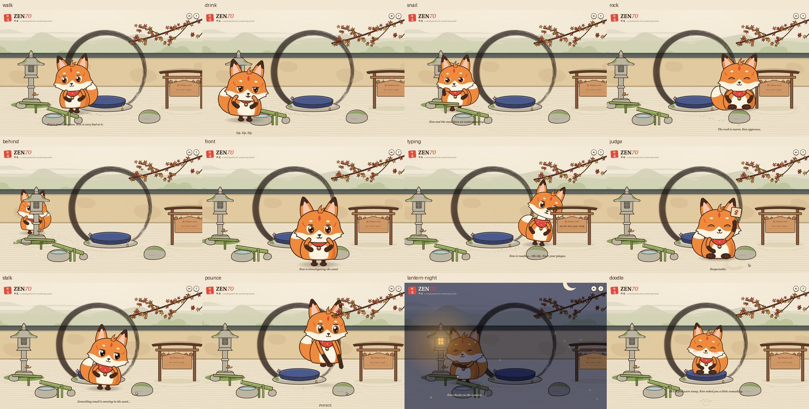

# ZEN70 · 禅道

A small zen garden, and the fox who lives in it. **Kon** is a novice kitsune monk in a red Inari bib. Kon is supposed to be meditating, but is very bad at it.

Kon has a life of its own. It wanders the garden: sniffing the flower, drinking at the basin, bothering the snail, sunbathing on the warm rock, and jumping every time the bamboo clacks. It also secretly watches you. When you notice, it pretends it was doing something else entirely.



## Run it

No build step and no dependencies, only Python 3:

```bash
python3 serve.py
```

Then open **http://localhost:8070**. If that port is already taken, `serve.py` uses the next free one (8071, 8072, …) and prints the address. `python3 serve.py 9000` asks for a specific port. Any static server also works; `serve.py` just turns off caching so edits show up on reload.

Useful URLs:

| URL | What it is |
| --- | --- |
| `/` | the garden |
| `/?debug` | live overlay: state, activity, attention, curiosity, meditation progress |
| `/?motion=full` | every movement, even if your system asks for reduced motion |
| `/?reduced` | force reduced-motion behavior |
| `/?hour=21` | pretend it's 9 pm (the garden follows your local time) |
| `/tests/` | 40 behavior tests (simulated input, deterministic) |
| `/?demo=pounce` | a scripted moment, frozen for a screenshot (see below) |

Fonts come from Google Fonts (Fraunces, Kalam, Ma Shan Zheng). Offline, the page falls back to system fonts.

**Reduced motion:** if your operating system asks for reduced motion, Kon tones down big movements. The pounce leap, the dizzy spin and floating hearts are skipped, and leaning and stretching shrink to about a third. Add `?motion=full` to see everything.

## Things to try

**Kon's life**
- Do nothing and watch. Kon sits a while, then picks somewhere to go, based on what it hasn't visited lately. It walks there with momentum and hops on and off the cushion and rock. It shrinks as it walks toward the wall and passes behind the lantern. Its paws leave prints in the sand.
- Shake the maple. When a leaf lands, Kon trots over and pounces on it.
- At night (light the lantern, or visit after 7 pm) Kon warms its paws at the lantern, and your cursor becomes a firefly.

**Secretly watching you**
- Move the mouse for a while. Kon's eyes, head and body follow, each with its own lag. It gets curious, tilts its head, stretches its neck, and may walk a few steps closer to see.
- **Stop.** Kon freezes ("uh-oh"), plops down and plays an innocence act. Move again and Kon side-eyes you before giving up the act. Freeze during the side-eye and Kon snaps straight back into it.
- **Move slowly along the sand, then freeze.** Foxes hunt: Kon crouches, sneaks closer, wiggles, and pounces on the cursor in a high arc. It finds nothing and claims it was only stretching.
- **Rush the cursor at Kon** to catch it peeking. Repeated catches escalate: startled, then hiding behind its paws (peeking through), then a pout with crossed arms, then sticking out its tongue.
- **Click the wish plaque and type.** Kon walks over and stands on tiptoe to read over your shoulder. Stop typing and it pretends to be reading the other wishes. Press Enter and your wish folds into a paper crane and flies off.

**Stillness**
- **Be perfectly still.** Kon walks home to the cushion and checks whether you're really gone: it waves, pulls faces, plays peekaboo, dances. Flinch, and Kon gloats. Hold out, and a spirit brush paints the big ensō stroke by stroke while Kon truly meditates. Any movement and the ink evaporates. At the end comes satori: Kon floats, the ensō turns gold, and a 悟 seal is stamped (the seal counts your satori). Then Kon drops.

**The sand**
- **Drag across the sand** to rake it. The grooves slowly smooth themselves away. Rake a circle and Kon walks over to judge it with a score card. Rake a spiral and Kon gets dizzy following it.

**Everything else**
- Boop the nose (Kon sneezes). Rub the head back and forth. Circle Kon quickly (spiral eyes). Tap the bamboo, poke the snail.
- Come back later. Kon greets returning visitors, and after a long absence it has raked a doodle in the sand for you.

Nothing typed is read or stored: Kon only receives "an input happened" events (see `js/input.js`). Kon's memory of you (visit count, satori count) stays in this browser's local storage.

## How it's built

Plain ES modules, hand-drawn SVG, canvas for ink and sand, and one `requestAnimationFrame` loop. There's no framework.

```
InputTracker (js/input.js)   raw DOM events → "senses" (pointer, typing, events)
      ↓
Brain        (js/brain.js)   senses → intent: a pose, plus where Kon wants to be
  ├ Acts     (js/acts.js)    authored performances: innocence acts, idle and life activities
  └ World    (js/world.js)   the ground: perspective, obstacles, platforms, places, paths
      ↓
Mover        (js/mover.js)   intent → motion: gaits, momentum, path following, jumps, footfalls
      ↓
FoxRig       (js/rig.js)     pose + motion → ~65 springs → SVG (legs, walk cycle, facing, tail)
Scene        (js/scene.js)   camera, parallax, depth sorting, garden props
  ├ SandRake (js/rake.js)    raked grooves, paw prints, circle judging
  └ ZenFX    (js/zen.js)     the live ensō, spirit brush, aura and seal
```

- **A ground with perspective.** Every point on the ground has a depth scale. Kon is 1.15× at the cushion, about 0.9× near the wall, and about 1.5× right in front of you. Moving toward or away from the viewer covers fewer screen units than moving sideways. The scenery is sorted by where it meets the ground, and Kon is re-inserted among it as it walks, so it passes behind the lantern and in front of the rock.
- **A body with momentum.** The brain only says where it wants to be. The mover accelerates with limited force, slows down on arrival, and walks around obstacles (a tiny planner: detours around ellipses, replanning when stuck). It hops onto the cushion and rock and flies ballistic arcs for pounces. Footfalls drive paw prints in the sand; landings squash the rig.
- **A rig that walks.** Kon's upper body rises on short legs when it stands. The feet step in a walk cycle (bigger bounce when trotting), the arms swing, the body leans into the turn, the belly and bib shift to suggest a three-quarter view, and the tail swings over to trail behind.
- **A camera.** On wide screens it pans gently with Kon. On phones it follows Kon around the garden. Hills, trees and the wall move at different rates, which gives the parallax depth.
- **Different delays for eyes, head and body.** Each rig channel is a damped spring with its own frequency: eyes about 9 Hz, head about 3 Hz, body about 1.6 Hz. Ears, the tuft, the bib bell and the tail take their motion from those.
- **Two layers of behavior.** A *life* layer chooses activities by novelty, whim and distance whenever nobody's around. A *social* layer reacts to you (watch, peek, pretend, startle, stalk, read, judge) and always wins. The state machine: `IDLE (life) → WATCH → NOTICED → PRETENDING → RESUMING`, plus `STARTLED`, `POUNCE`, `JUDGE`, `ZAZEN → SATORI`, `DROWSY → SLEEPING → WAKING`, `GOTCHA`, `DIZZY`, `PETTED`, `BOOPED`, `ADMIRE`.

## Verification

- **`/tests/`**: 40 scenario tests drive the real `Brain` *and* `Mover` with simulated input on a seeded random generator. Highlights:
  - tracking, stop → pretend, resume, snap-back, act variety, escalating startles;
  - typing and mouse as independent sources;
  - the stillness game (temptation, gotcha, breaking and restarting, jitter tolerance, satori), and stroke analysis (circles, ovals, spirals);
  - the world: Kon wanders when left alone and goes home to meditate; walking between every pair of places never enters scenery; hopping on and off the cushion; momentum; walking over to read; stalk → pounce → miss; pouncing on a leaf; walking over to judge a circle;
  - a 60-step random session with NaN checks.

  **40/40 pass.**
- **`/?demo=<name>`**: runs a scripted input sequence through the real pipeline on a virtual clock and freezes on one moment. A drawn cursor shows where the "mouse" is. Examples: `go&to=basin&t=2.4`, `at&to=rock`, `go&x=300&y=760&t=14` (behind the lantern), `stalk2`, `pounce`, `typing`, `judge&t=5.2`, `zazen&t=0.6`, `satori`, `tempt`, `gotcha`, `doodle&visits=3&away=5`, `night`, and the older `peek`, `noticed`, `pretend&act=whistle`, `resume`, `startle`, `cover`, `pout`, `bleh`, `sleep`, `dizzy`, `pet`, `boop`, `admire`.
- **`PORT=8070 tests/screenshots.sh`** captures 41 of them at desktop (1440×900) and phone (390×844) size with headless Firefox into `docs/screenshots/`.
- **Performance**: script work is about 0.3–0.5 ms per frame, measured in the virtual-clock mode. That excludes the browser's own paint time. Static scenery sits on its own layers, and the sand canvas pans with a CSS transform instead of being redrawn.


## Known limitations

- **Live 60 fps feel was not watched in real time.** The in-app browser pane was hidden during development, which pauses animation frames. Motion was verified frame by frame on the virtual clock and with screenshots, not live. Walking speed, spring stiffness and act timing may want a tuning pass once you've played with it.
- **Not tested on real phones.** Touch input, the following camera and the on-screen keyboard layout were checked only with emulated viewports.
- **No back view.** Kon always shows its face. When walking straight away from you it turns to a three-quarter view instead of showing its back.
- **The wish plaque is an HTML form on top of the garden,** so it always draws in front of Kon. Kon's reading spot sits just beside it to avoid overlapping.
- **Falling leaves draw in front of everything**, even when they land behind Kon.
- **Kon's eyes follow an estimate of the caret**, based on how many input events happened, not the real caret.
- **Sound** is a few basic synthesized effects, off by default.
- `js/demo.js` (verification helpers) ships with the page. Drop it before production.

## Files

```
index.html          the scene (SVG art for the garden and Kon), plaque, controls
css/style.css       palette, paint classes, layout, night/dusk, effects
js/main.js          wiring and the animation loop
js/input.js         pointer + typing tracker (no text is read)
js/brain.js         behavior: life layer + social layer + state machine
js/acts.js          innocence acts, idle behaviors, life activities, temptations
js/world.js         ground, perspective, obstacles, platforms, places, path planning
js/mover.js         locomotion: gaits, momentum, jumps, footfalls
js/rig.js           springs → SVG: face, body, legs, walk cycle, tail, effects
js/scene.js         camera, parallax, depth sorting, layout, garden props
js/rake.js          raking, paw prints, stroke analysis, doodles
js/zen.js           live ensō, spirit brush, aura, satori seal
js/enso.js          the procedural sumi brush
js/memory.js        what Kon remembers about you (localStorage)
js/captions.js      the narrator's lines
js/audio.js         tiny Web Audio synth
js/math.js          springs, easing, seeded random, shuffle bag, splines
js/clock.js         real or virtual clock
js/demo.js          scripted demos for screenshots
tests/              behavior tests and the screenshot script
serve.py            no-cache local server
```
