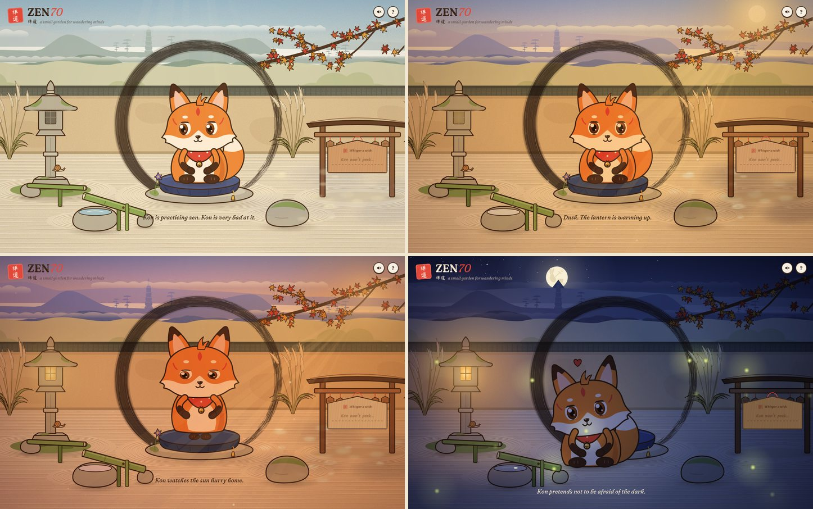
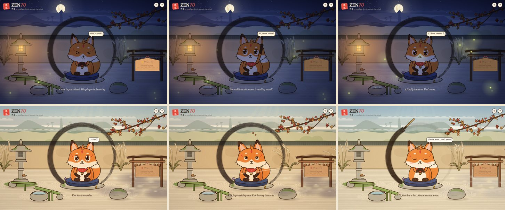
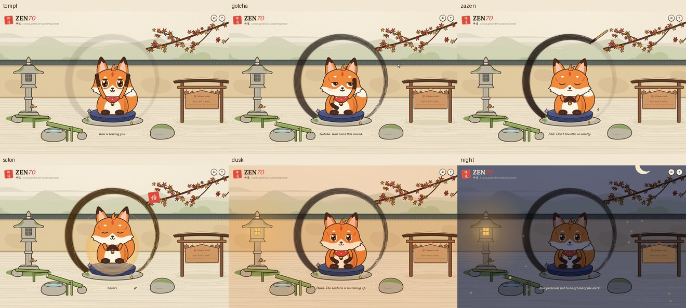
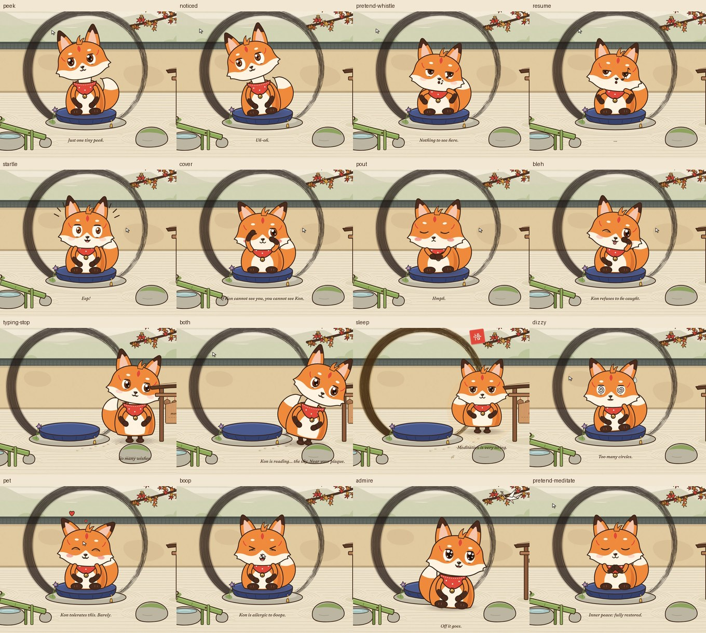
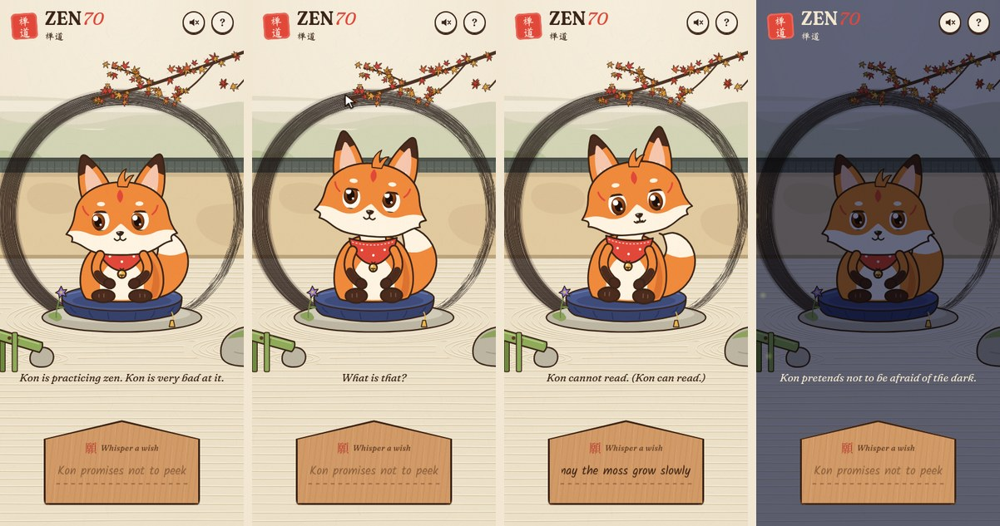

# ZEN70 · 禅道

A small zen garden, and the fox who lives in it. **Kon** is a novice kitsune monk in a red Inari bib. Kon is supposed to be meditating, but is very bad at it.

Kon has a life of its own. It wanders the garden: sniffing the flower, drinking at the basin, bothering the snail, sunbathing on the warm rock, and jumping every time the bamboo clacks. It also secretly watches you. When you notice, it pretends it was doing something else entirely.

The garden keeps your local time. The light changes through the day, the wind comes and goes, and after dark there are stars, a full moon, and fireflies.



## Run it

No build step and no dependencies, only Python 3:

```bash
python3 serve.py
```

Then open **http://localhost:8070**. If that port is already taken, `serve.py` uses the next free one (8071, 8072, …) and prints the address. `python3 serve.py 9000` asks for a specific port. Any static server also works; `serve.py` just turns off caching so edits show up on reload.

Useful URLs:

| URL | What it is |
| --- | --- |
| `/` | the garden |
| `/?debug` | live overlay: state, activity, attention, curiosity, meditation progress |
| `/?motion=full` | every movement, even if your system asks for reduced motion |
| `/?reduced` | force reduced-motion behavior |
| `/?hour=21` | pretend it's 9 pm (the garden follows your local time) |
| `/tests/` | 51 behavior tests (simulated input, deterministic) |
| `/?demo=pounce` | a scripted moment, frozen for a screenshot (see below) |

Fonts come from Google Fonts (Fraunces, Kalam, Ma Shan Zheng). Offline, the page falls back to system fonts.

**Reduced motion:** if your operating system asks for reduced motion, Kon tones down big movements. The pounce leap, the dizzy spin and floating hearts are skipped, and leaning and stretching shrink to about a third. Add `?motion=full` to see everything.

## Things to try

**Kon's life**
- Do nothing and watch. Kon sits a while, then picks somewhere to go, based on what it hasn't visited lately. It walks there with momentum and hops on and off the cushion and rock. It shrinks as it walks toward the wall and passes behind the lantern. Its paws leave prints in the sand.
- Shake the maple. When a leaf lands, Kon trots over and pounces on it.
- **A sparrow drops by** now and then (by day). It perches on the lantern, the wish rack, the rock, the basin rim or the sand, hops about, pecks, and cocks its head. On the sand it's prey: Kon creeps up low and slow, wiggles, and pounces. The sparrow always gets away (sometimes it spots Kon coming). Up out of reach, Kon sits below and chatters at it. Swipe or tap near the bird and it's gone. Hold perfectly still while Kon meditates, and it may land on Kon's head. Kon must not move.
- At night (light the lantern, or visit after 7 pm) Kon warms its paws at the lantern, and your cursor becomes a firefly.

**The sky and the weather**
- **Light the lantern.** It doesn't flip a switch, it runs the clock: the afternoon turns gold, the sun slides behind the hills through shafts of light, the sky goes orange and violet, and the full moon rises behind the pagoda. Kon turns to watch ("Whoa. Pretty…"). Put the lantern out and the night flies by into morning. Click it again halfway and the clock runs back.
- **Wait for the wind.** Every half minute or so a gust runs through: the maple lets go of a few leaves, the pampas grass bows, curls of wind draw themselves through the air like brush strokes, fallen leaves skitter over the sand. Kon's ears stream, and if it's resting it turns its face into the wind and enjoys it. Gust-blown leaves are fair game for a pounce.
- **At night, look up.** A shooting star crosses the sky now and then, and Kon makes a wish. Catch one (click or tap it) and the wish plaque glows gold: a wish sent while it glows leaves on a golden crane. Poke the moon and the rabbit in it pounds its mochi. Kon waves.
- **Sit still and watch Kon.** A falling leaf may settle on its head (eyes up, then a big puff). After dark a firefly sometimes lands on its nose: a long cross-eyed stare, then a sneeze.
- With sound on: crickets after dark, a bird now and then by day, the rush of a gust.



**Secretly watching you**
- Move the mouse for a while. Kon's eyes, head and body follow, each with its own lag. It gets curious, tilts its head, stretches its neck, and may walk a few steps closer to see.
- **Stop.** Kon freezes ("uh-oh"), plops down and plays an innocence act. Move again and Kon side-eyes you before giving up the act. Freeze during the side-eye and Kon snaps straight back into it.
- **Move slowly along the sand, then freeze.** Foxes hunt: Kon crouches, sneaks closer, wiggles, and pounces on the cursor in a high arc. It finds nothing and claims it was only stretching.
- **Rush the cursor at Kon** to catch it peeking. Repeated catches escalate: startled, then hiding behind its paws (peeking through), then a pout with crossed arms, then sticking out its tongue.
- **Click the wish plaque and type.** Kon walks over and stands on tiptoe to read over your shoulder. Stop typing and it pretends to be reading the other wishes. Press Enter and your wish folds into a paper crane and flies off.

**Stillness**
- **Be perfectly still.** Kon walks home to the cushion and checks whether you're really gone: it waves, pulls faces, plays peekaboo, dances. Flinch, and Kon gloats. Hold out, and a spirit brush paints the big ensō stroke by stroke while Kon truly meditates. Any movement and the ink evaporates. At the end comes satori: Kon floats, the ensō turns gold, and a 悟 seal is stamped (the seal counts your satori). Then Kon drops.

**The sand**
- **Drag across the sand** to rake it. The grooves slowly smooth themselves away. Rake a circle and Kon walks over to judge it with a score card. Rake a spiral and Kon gets dizzy following it.

**Everything else**
- Boop the nose (Kon sneezes). Rub the head back and forth. Circle Kon quickly (spiral eyes). Tap the bamboo, poke the snail.
- Come back later. Kon greets returning visitors, and after a long absence it has raked a doodle in the sand for you.

Nothing typed is read or stored: Kon only receives "an input happened" events (see `js/input.js`). Kon's memory of you (visit count, satori count) stays in this browser's local storage.

## How it's built

Plain ES modules, hand-drawn SVG, canvas for ink and sand, and one `requestAnimationFrame` loop. There's no framework.

```
js/input.js            raw DOM events → "senses" (pointer, typing, events)
  ↓
js/kon/                Kon
  brain.js             perception, attention, events, the state machine's plumbing
  life.js · social.js · stillness.js · play.js    the states, grouped by what they're about
  visitors.js          Kon and the sparrow: notice, stalk, watch, pounce, be a perch
  acts.js · captions.js · voice.js                authored performances, the narrator, Kon's own lines
  mover.js             intent → motion: gaits, momentum, path following, jumps, footfalls
  rig.js               motion + pose → springs → SVG (face.js, limbs.js, effects.js)
js/garden/             the garden
  world.js             the ground: perspective, obstacles, platforms, places, paths
  scene.js             framing, camera, parallax, depth sorting, overlays (art.js, props.js)
  sky.js               the clock: a palette per hour, the sun and moon, the lantern's time-lapse
  light.js             the light map over the garden, sun shafts and dust, leaf shade
  wind.js · night.js   gusts and pampas grass; shooting stars, the moon rabbit, a firefly
  birds.js             the sparrow: perches, flight, hops and pecks, what scares it
  rake.js · zen.js · enso.js                      raking and paw prints, the live ensō, the brush
js/main.js             wiring and the loop · util.js, math.js, clock.js, memory.js, audio.js, demo.js
```

The brain, rig and scene are each one class whose methods are grouped into a few files by responsibility (`mixin(Brain, Life, Social, Stillness, Play, Visitors)`). A state's code lives next to related states, not in one long file.

- **A ground with perspective.** Every point on the ground has a depth scale. Kon is 1.15× at the cushion, about 0.9× near the wall, and about 1.5× right in front of you. Moving toward or away from the viewer covers fewer screen units than moving sideways. The scenery is sorted by where it meets the ground, and Kon is re-inserted among it as it walks, so it passes behind the lantern and in front of the rock.
- **A body with momentum.** The brain only says where it wants to be. The mover accelerates with limited force, slows down on arrival, and walks around obstacles (a tiny planner: detours around ellipses, replanning when stuck). It hops onto the cushion and rock and flies ballistic arcs for pounces. Footfalls drive paw prints in the sand; landings squash the rig.
- **A rig that walks.** Kon's upper body rises on short legs when it stands. The feet step in a walk cycle (bigger bounce when trotting), the arms swing, the body leans into the turn, the belly and bib shift to suggest a three-quarter view, and the tail swings over to trail behind.
- **Light, painted per hour.** A palette for each key hour (dawn, morning, noon, afternoon, golden hour, sunset, dusk, night) is blended for the current minute. The far scenery gets its colors from it. The garden itself is lit by a small light map: ambient color, brighter toward the sun or moon, the lantern's warm pool, fireflies, leaf shade, a vignette. From golden hour to dawn it is multiplied over the garden; in daylight it is a plain see-through overlay, because blending a whole screen is costly without a GPU. The far scenery's paint is divided by the light that will fall on it, so the sky ends up exactly the color the palette asks for.
- **A camera.** On wide screens it pans gently with Kon. On phones it follows Kon around the garden. Hills, trees and the wall move at different rates, which gives the parallax depth.
- **Different delays for eyes, head and body.** Each rig channel is a damped spring with its own frequency: eyes about 9 Hz, head about 3 Hz, body about 1.6 Hz. Ears, the tuft, the bib bell and the tail take their motion from those.
- **Two layers of behavior.** A *life* layer chooses activities by novelty, whim and distance whenever nobody's around. A *social* layer reacts to you (watch, peek, pretend, startle, stalk, read, judge) and always wins. The state machine: `IDLE (life) → WATCH → NOTICED → PRETENDING → RESUMING`, plus `STARTLED`, `POUNCE`, `JUDGE`, `ZAZEN → SATORI`, `DROWSY → SLEEPING → WAKING`, `GOTCHA`, `DIZZY`, `PETTED`, `BOOPED`, `ADMIRE`.

## Verification

- **`/tests/`**: 58 scenario tests drive the real `Brain` *and* `Mover` (and the sparrow) with simulated input on a seeded random generator. Highlights:
  - tracking, stop → pretend, resume, snap-back, act variety, escalating startles;
  - typing and mouse as independent sources;
  - the stillness game (temptation, gotcha, breaking and restarting, jitter tolerance, satori), and stroke analysis (circles, ovals, spirals);
  - the world: Kon wanders when left alone and goes home to meditate; walking between every pair of places never enters scenery; hopping on and off the cushion; momentum; walking over to read; stalk → pounce → miss; pouncing on a leaf; walking over to judge a circle;
  - the sparrow: it ignores a still cursor but flees a fast one (away from it); it lands on Kon only in deep meditation and leaves when Kon stirs; Kon creeps up and pounces and never catches it; birds out of reach get watched, not pounced; typing beats birds;
  - the sky: a sane palette at every minute of the day (sun by day, moon and stars by night); the lantern's time-lapse spends clearly more of its time between golden hour and dusk than those hours' share, never runs backwards by accident, and rewinds when clicked again;
  - small moments: a gust makes a resting Kon enjoy the breeze (and doesn't wake a sleeping one); a shooting star gets a wish, but doesn't break real meditation; a firefly on the nose means a long cross-eyed stare and a sneeze that sends it off; a leaf on the head gets looked at and blown away; the moon rabbit gets a wave;
  - Kon's voice and the narrator never say the same line, and speech bubbles don't pile up;
  - a 60-step random session with NaN checks.

  **58/58 pass.**
- **`/?demo=<name>`**: runs a scripted input sequence through the real pipeline on a virtual clock and freezes on one moment. A drawn cursor shows where the "mouse" is. Examples: `go&to=basin&t=2.4`, `at&to=rock`, `go&x=300&y=760&t=14` (behind the lantern), `stalk2`, `pounce`, `typing`, `judge&t=5.2`, `zazen&t=0.6`, `satori`, `tempt`, `gotcha`, `doodle&visits=3&away=5`, `night`, `sparrow&perch=lantern&t=7`, `sparrow-hunt&phase=creep` (or `wiggle`, `air`, `land`), `sparrow-head`, `idle&hour=17.5` (any hour), `night&t=4.2` (mid time-lapse), `gust`, `meteor` (`&caught=1`), `moon`, `firefly`, `leafhat`, and the older `peek`, `noticed`, `pretend&act=whistle`, `resume`, `startle`, `cover`, `pout`, `bleh`, `sleep`, `dizzy`, `pet`, `boop`, `admire`.
- **`PORT=8070 tests/screenshots.sh`** captures 41 of them at desktop (1440×900) and phone (390×844) size with headless Firefox into `docs/screenshots/`.
- **Performance**: script work is about 0.3–0.5 ms per frame, measured in the virtual-clock mode. That excludes the browser's own paint time. Static scenery sits on its own layers, and the sand canvas pans with a CSS transform instead of being redrawn.







## Known limitations

- **Not watched by a person on a real display.** Motion was checked in real time in headless Firefox (software rendering, real mouse/keyboard/touch input through WebDriver), frame by frame on the virtual clock, and with film strips and screenshots. Frame rates measured there are a floor, not what a GPU-accelerated browser will do: about 50 fps idle by day and at night, and about 44 at golden hour, when the light map has to be multiplied over the whole screen. Walking speed, spring stiffness and act timing may still want a tuning pass once you've played with it.
- **Not tested on real phones.** Touch input, the following camera and the on-screen keyboard layout were checked only at emulated sizes (390×844) with synthesized touch events.
- **No back view.** Kon always shows its face. When walking straight away from you it turns to a three-quarter view instead of showing its back.
- **The wish plaque is an HTML form on top of the garden,** so it always draws in front of Kon. Kon's reading spot sits just beside it to avoid overlapping.
- **Falling leaves draw in front of everything**, even when they land behind Kon.
- **Kon's eyes follow an estimate of the caret**, based on how many input events happened, not the real caret.
- **Sound** is a few synthesized effects and a soft ambience (crickets, distant birds, gusts), off by default. They were only checked to be scheduled, not listened to.
- `js/demo.js` (verification helpers) ships with the page. Drop it before production.

## Tests

```bash
python3 tests/run.py [-v] [-k sparrow]     # 58 behavior tests + a boot check, headless Firefox
python3 tests/live/scenarios.py            # live: 13 scenarios, real mouse/keyboard/touch in real time, desktop + phone
python3 tests/visual_diff.py capture DIR   # pixel baseline of 24 scripted demos…
python3 tests/visual_diff.py compare DIR   # …and the diff after a change
python3 tests/live/observe.py --seconds 60 # watch the garden untouched: states, frame times, errors
python3 tests/live/perf.py --walk          # frame times with layers switched off one at a time
```

All of these need the dev server running (`python3 serve.py`) and Firefox installed. Add `--url http://localhost:PORT` if it isn't on 8070.
